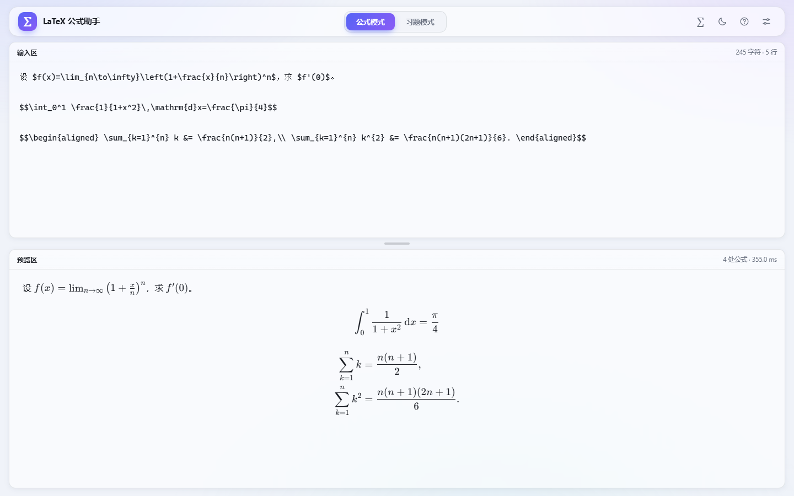
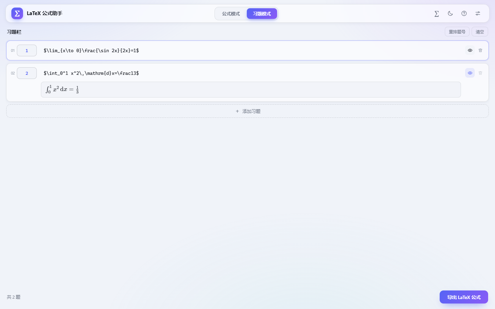
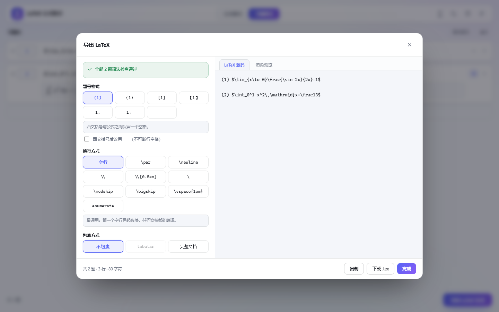
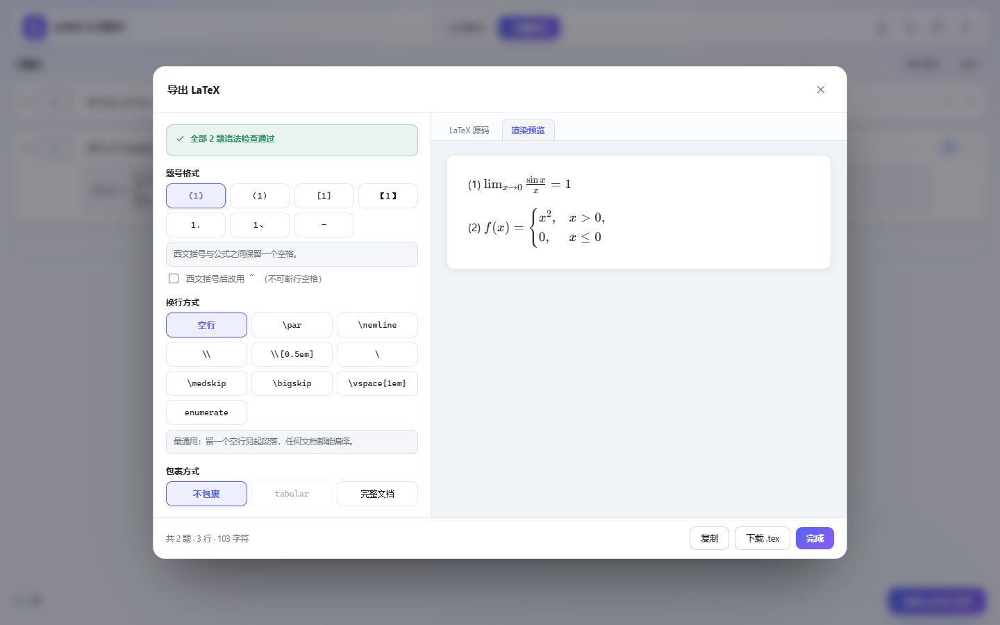
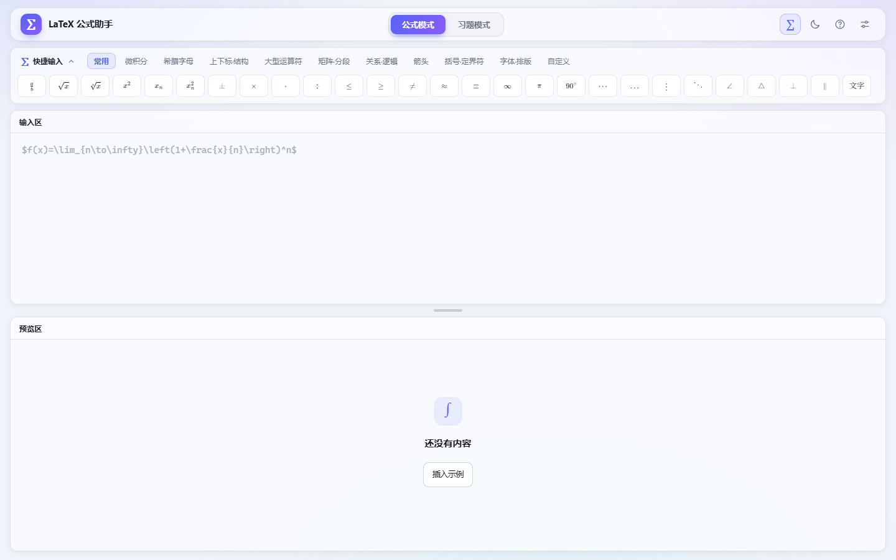
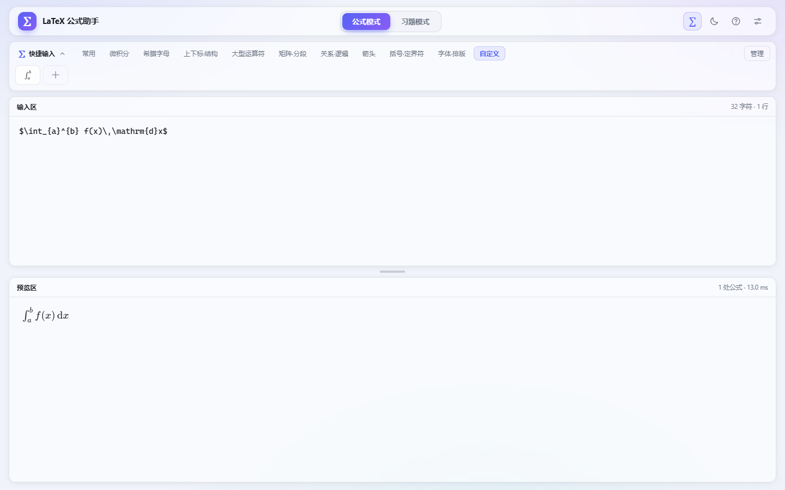
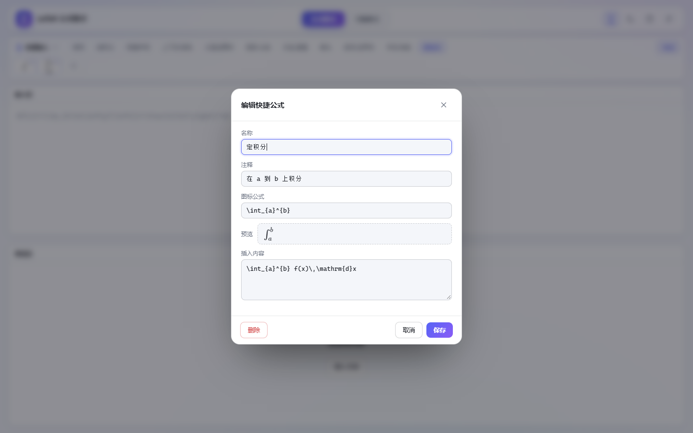
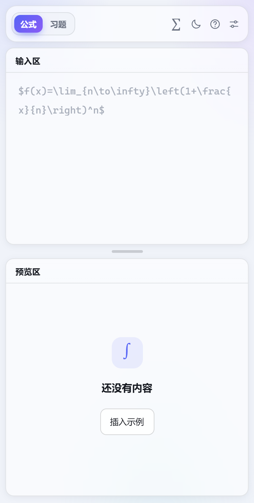

# LaTeX 公式助手

一个离线可用的单文件小工具：左边写 LaTeX，下边实时预览；也可以把若干道习题排好题号，检查语法后导出成 `.tex` 片段。

- 成品只有一个文件：`index.html`（约 746 KB，KaTeX 与字体全部内联，断网也能用）。
- 双击 `index.html` 即可在 Chrome / Edge（111+）中打开，无需安装、无需服务器。
- 数据自动保存在浏览器 localStorage 中，关掉页面不会丢。



---

## 一、公式模式

上半区是输入区，下半区是预览区，中间的分隔条可以拖动。

- 直接输入纯文本；数学内容自己用 `$...$`（行内）或 `$$...$$`（行间）包起来。
- 也支持 `\(...\)`、`\[...\]`。
- 预览实时刷新；语法错误会在出错位置显示红框，包含：
  - 出错行号
  - 出错片段与 `^` 定位
  - KaTeX 的原始报错
  - 中文提示（例如“花括号没有闭合”“`\left` 与 `\right` 必须成对”）
- `\begin{align*}`、`\begin{gather*}` 这类行间环境可以直接写在正文里；`cases`、`matrix` 等必须放进 `$...$`，否则预览会提示。

快捷键：`Esc` 关闭弹窗。

## 二、习题模式



- 点“＋ 添加习题”增加一栏；左侧题号框可改成任意题号（默认按顺序递增）。
- 每行右侧的眼睛按钮可以单独打开该题的**渲染预览**，再点一次收起；每题的开关相互独立，刷新后仍保留。
- 右上角有“重排题号”“清空”。
- 在任一公式框里按 `Ctrl + Enter` 可以快速新增下一题。
- 点“导出 LaTeX 公式”打开导出面板：
  1. **先检查语法**：逐题解析，错误精确到题号和行号；点错误条目会关掉面板并跳到对应输入框，输入框下方同时显示错误原因。
  2. **选择题号格式**：`(1) `、`（1）`、`[1] `、`【1】`、`1. `、`1、`、不输出题号。
     - 西文括号与公式之间自动留一个空格（可勾选改用不可断行空格 `~`）。
     - 中文括号紧排，不加空格。
  3. **选择换行方式**：

     | 选项 | 实际输出 | 适用位置 |
     | --- | --- | --- |
     | 空行 | 两题之间空一行（分段） | 任意文档，最稳妥 |
     | `\par` | `\par` | 任意文档 |
     | `\newline` | `\newline` | 正文可用，紧凑换行不分段 |
     | `\\` | `\\` | 只在表格、数学、align 等环境内合法；正文直接用会报 “There's no line here to end” |
     | `\\[0.5em]` | `\\[0.5em]` | 同上，额外留 0.5em 行距 |
     | `\` | 行尾一个 `\`（最后一行不加） | Markdown 等以行尾 `\` 表示硬换行的场合；LaTeX 编译会报错 |
     | `\medskip` | `\par\medskip` | 任意文档，约 6pt 间距 |
     | `\bigskip` | `\par\bigskip` | 任意文档，约 12pt 间距 |
     | `\vspace{1em}` | `\par\vspace{1em}` | 任意文档，自定义间距 |
     | enumerate | `\begin{enumerate} ... \end{enumerate}` | 任意文档，自动编号，题号作为 `\item[...]` 标签 |

  4. **选择包裹方式**：
     - 不包裹：只输出题目行。
     - tabular：用 `\begin{tabular}{@{}p{\linewidth}@{}}` 包住，让 `\\` 在正文中也能编译（仅在选 `\\` 时可选）。
     - 完整文档：生成可直接编译的 `ctexart` 文档（含 `amsmath`、`amssymb`），选 `\\` 时会自动套一层 tabular。
  5. 右侧是导出结果，可在「LaTeX 源码」与「渲染预览」两个标签页之间切换；渲染预览会按当前题号格式、换行方式把题目排出来，方便检查观感。可以“复制”或“下载 .tex”。





> 导出结果默认只有题目片段，需要粘贴到现有文档中；若选了“完整文档”则会带上前导区。

## 三、快捷输入（符号栏）

- 默认收起，界面上只留右上角一个 **∑** 按钮；点它或按 `Ctrl + /` 展开，展开后点左上角「∑ 快捷输入」收起，状态会记住。
- 展开后顶部是 10 个内置分类：常用、微积分、希腊字母、上下标·结构、大型运算符、矩阵·分段、关系·逻辑、箭头、括号·定界符、字体·排版，约 200 个符号与模板。
- 最后一个「自定义」分类可以放自己的快捷公式。



- 鼠标悬停在按钮上会弹出小窗：显示**渲染效果**、**要输入的代码**、**中文说明**。
- 点击插入到当前光标处；如果光标已经在 `$…$` 内（例如 `$|$`），不会再额外包一层 `$`；不在数学环境里时才自动补 `$...$`（可在设置中关闭）。
- 分段函数、aligned、align\*、gather\*、各种矩阵、左花括号组都在“矩阵·分段”里。

### 自定义快捷公式



- 打开「自定义」分类，点虚线 **＋** 新建。
- 填写：**名称**、**注释**、**图标公式**（这段 LaTeX 会渲染成按钮上的图标）、**插入内容**（真正插入到输入框的代码）。
- 图标输入框下方有实时预览；图标公式写错时不会保存，并会显示 KaTeX 的报错。
- 保存后按钮的图标、悬停小窗、插入行为都和内置符号完全一致；插入时同样会按需补 `$`。
- 点分类右侧的「管理」，按钮右上角出现铅笔标记；此时点某个自定义按钮会打开编辑框，可以修改或删除（删除在弹窗左下角）。
- 自定义内容保存在本地，换浏览器不会同步。



## 四、自动补全

- 输入 `$`、`{`、`(`、`[` 会自动补上另一半，光标停在中间；再输入同种右括号会跳过。
- 退格键在空括号/空 `$` 上会成对删除。
- 输入 `\left` 后打 `(`，会自动补 `\right)`；输入 `\[` 会自动补 `\]`。
- 连续快速按两次 `$` 可以得到 `$$...$$`。
- **`$` 补全优化**（设置里，默认开启）：光标已经在 `$…$` 内时，再输入 `$` 只补一个结束符，而不是又成对插入；关掉后回到“总是成对插入”。
- 这些行为可以在右上角齿轮里整体关闭。

## 五、外观与数据

- 右上角月亮/太阳按钮一键切换浅色、深色；设置里还可以选“跟随系统”。
- 设置里可以上传背景图片（自动压缩到 1920px 宽、JPEG），并调节**不透明度**与**模糊度**。
- 面板是半透明的毛玻璃效果，背景图会透出来。
- 设置最下方有「清除本地缓存」：删除本机保存的公式、习题、主题、背景和自定义快捷公式，并恢复默认状态（不可撤销）。

### 窄屏 / 手机



- 宽度 ≤860px 时隐藏品牌名（保留 logo）；≤720px 时模式按钮缩成「公式 / 习题」、图标按钮变小；≤560px 时隐藏整个品牌区，模式切换靠左，避免顶栏按钮重叠。

## 六、快捷键

| 快捷键 | 作用 |
| --- | --- |
| `Ctrl + /` | 展开 / 收起快捷输入 |
| `Ctrl + Enter` | 习题模式：新增一题 |
| `Ctrl + Shift + E` | 习题模式：打开导出面板 |
| `Esc` | 关闭弹窗 / 设置 / 悬浮窗 |

## 七、项目结构与重新构建

```
index.html        成品，单文件，直接打开
src/index.html    界面骨架（含占位符）
src/app.css       样式
src/app.js        交互逻辑
src/palette.js    符号与模板数据
build.mjs         构建脚本（内联 KaTeX 与字体）
vendor/katex/     KaTeX 0.16.11 的 katex.min.js / katex.min.css / fonts
```

修改 `src/` 后重新生成：

```bash
node build.mjs
```

脚本只依赖 Node 内置模块，会把 KaTeX 的 20 个 woff2 字体转成 base64 一并写进 `index.html`。

## 八、说明与限制

- 渲染使用 [KaTeX](https://katex.org/)（MIT License，见 `vendor/katex/LICENSE`），它只支持 LaTeX 的一个子集；`\usepackage`、自定义命令、TikZ 等不可用。
- 导出的是公式片段，目标文档需要能处理数学环境（一般加 `\usepackage{amsmath,amssymb}`；中文文档建议 `ctexart`/`ctex`）。
- `\\` 的合法性取决于所在环境，导出面板会给出提示；不确定时用“空行”或“tabular”包裹。
- 文本输入是纯文本，工具不会替你补 `$`；只有点击符号栏时才会按需自动包裹（可关闭）。
- 数据保存在当前浏览器的 localStorage 中，换浏览器或清理站点数据会丢失。
- 用了 `color-mix()` 与 `backdrop-filter`，建议使用较新的 Chrome / Edge。
